# Design Review: Aufgabentypen und Lernansichten

Die neuen Antwortfelder sind in das bestehende Design integriert. Im Karteneditor
werden Aufgabentyp und bei Rechenaufgaben zusätzlich das Antwortformat gewählt.
Smart Study verwendet passende Eingaben bei aktivierter Technik „Antwort eingeben“.
Lernen zeigt Frage und Musterlösung. Die manuelle Lernbewertung bleibt erhalten.

Die abschließende Layoutprüfung umfasst 196 Aufnahmen in sieben Größen. In den
geprüften Zuständen gibt es keinen horizontalen Seiten-/Dialogüberlauf, keine
unerreichbaren geprüften Bedienelemente und keine Rendererfehler. Weitere 99
Aufnahmen prüfen alle zwölf Antwortformate in Editor, Smart Study und Lernen.

## Geprüfte Schritte

| Schritt | Ansicht und Ergebnis | Zustand nach Korrektur |
| --- | --- | --- |
| 1 | Bibliothek, Importmenü, Kartenliste und leere Bibliothek: responsive Karten-/Tabellendarstellung, Menü im sichtbaren Bereich, Aktionen durch Scrollen erreichbar. | Gut |
| 2 | Karten- und Stapeleditor: Aufgabentyp, Antwortformat, Musterlösung, Vorschau; Dialog scrollt, Speichern bleibt erreichbar. | Gut |
| 3 | Smart-Study-Konfiguration und Einstellungen: lange Stapel-/Modellnamen, Schalter, Startbutton, Hell-/Dunkelmodus. | Gut |
| 4 | Antwort eingeben: Text, Erklärung, Zahl, Bruch, Wert/Einheit, Formel, Einfach-/Mehrfachauswahl, Wahr/Falsch, Lückentext, Zuordnung und Reihenfolge. Lückentext wird direkt in der Frage ausgefüllt. | Gut |
| 5 | Smart-Study-Ergebnis: Musterantwort einmal, eigene Antwort und Rechenweg getrennt; Bewertung, KI-Fehler, Pause und Abschluss. | Gut |
| 6 | Lernen: lesbare strukturierte Aufgaben, Frage-/Antwortwechsel, vier Bewertungsbuttons und Abschluss. | Gut |
| 7 | Symboltastatur: beide App-Farbschemata, Editor mit Fehlermeldung, Querformat und 400 % Zoom. Bei zu wenig Höhe schließt die Symboltastatur mit Hinweis; Formel und LaTeX-Modus bleiben verfügbar. | Gut, begrenzte Höhe erfordert Scrollen |
| 8 | KI-Verbrauch: Kosten vollständig sichtbar; auf Tablet-Breite zweispaltige Kennzahlen, auf Mobilgröße responsive Detailkarten. | Gut |

## Behobene Befunde

- **Schritt 5:** Die Musterantwort erschien in Lösungskarte und Feedback doppelt.
  Sie wird jetzt einmal gezeigt. Auch Lückentext-Frage und Eingabe sind zusammengeführt.
- **Schritte 4–6:** Smart Study hatte unnötige Mindesthöhe im Fragenbereich.
  Der Bereich passt sich stärker dem Inhalt an. Zuordnungsbegriffe bleiben auf
  320 px breiten Ansichten lesbar.
- **Schritt 7:** MathLive verwendete im hellen App-Design teilweise dunkle
  Systemfarben. Tastatur, Tasten, aktive Zustände und Tastaturbutton verwenden
  jetzt die vorhandenen App-Farben.
- **Schritt 7:** Eine Fehlermeldung konnte hinter der Symboltastatur liegen.
  Meldungen stehen darüber; der Dialog reserviert Platz für beide. Bei sehr
  geringer Höhe schützt die automatische Schließung die Formeldarstellung.
  Die Fokusposition wird auch nach Meldungen und Tastaturschließung angepasst.
- **Schritt 8:** Ein Kostenwert wurde auf Tablet-Breite abgeschnitten.
  Die Kennzahlen erhalten dort zwei Spalten und zeigen den vollständigen Wert.
- **Schritt 2:** Die Fokusbegrenzung berücksichtigt Mathfelder und aufklappbare
  Vorschauen; eingeklappte oder unsichtbare Eingaben werden übersprungen.
- **Schritte 2–4:** Sortier- und Entfernen-Schaltflächen verwenden die bestehenden
  App-Icons. Eingabefelder verwenden vorhandene Farben, Radien und Fokusmarkierungen.
- **Schritt 5:** Bei fehlgeschlagener KI-Prüfung eines Rechenwegs benennt der
  Hinweis das bereits lokal geprüfte Ergebnis korrekt. Eingaben bleiben erhalten.

## Zusammengeführte Komponenten

Beide Lernansichten verwenden `StudyHeader`, `StudyCardBody`, `StudyRatingButtons`
und `StudyCompletion`. Dadurch teilen sie Frage-/Lösungsdarstellung, Tastaturkürzel,
Bewertungsbuttons und Sitzungsabschluss. Standard-Lernen zeigt zusätzlich die
Intervallvorschau; Smart Study ergänzt Antwortprüfung und Rechenweg. Die jeweiligen
Session-Stores verwalten ihre unterschiedlichen Ablaufregeln.

## Screenshots

Die Dateien sind unveränderte Originalaufnahmen aus diesem Review. Sie wurden
vor Aufnahme in den Bericht visuell geprüft. Ansichten mit weniger Platz zeigen
einen Ausschnitt des scrollbaren Inhalts.

1. Bibliothek und Importmenü.

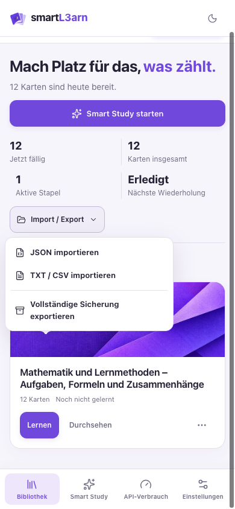

2. Aufgaben- und Antwortformat im Editor.

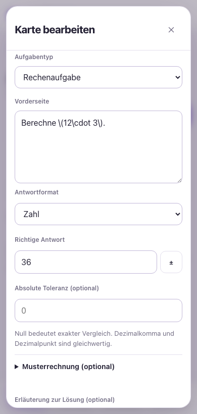

3. Brucheingabe mit Dezimalalternative und Vorzeichenwechsel.

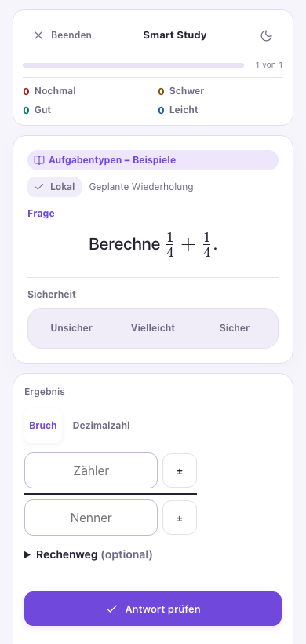

4. Lückentext direkt in der Frage.

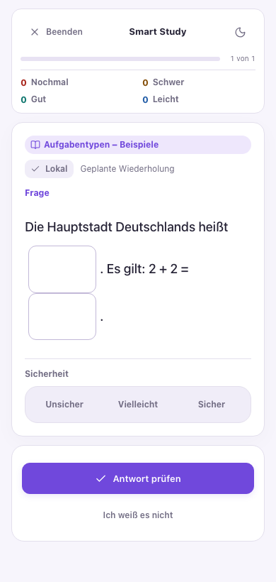

5. Smart-Study-Ergebnis mit einer Musterantwort und separatem Rechenweg.

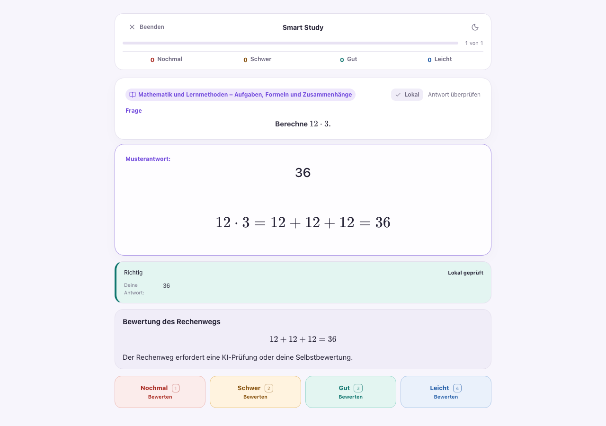

6. Strukturierte Aufgabe in Lernen auf 320 px Breite.

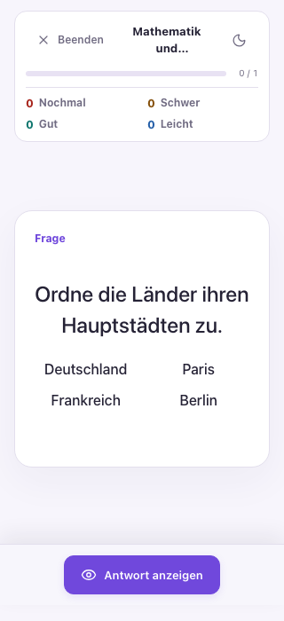

7. Helle Formeltastatur und dunkler Editor mit sichtbarer Fehlermeldung.

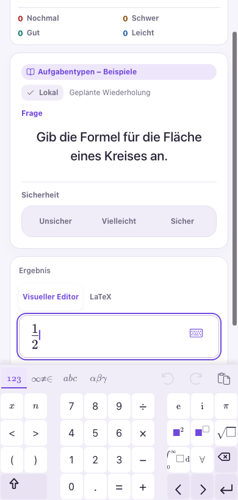

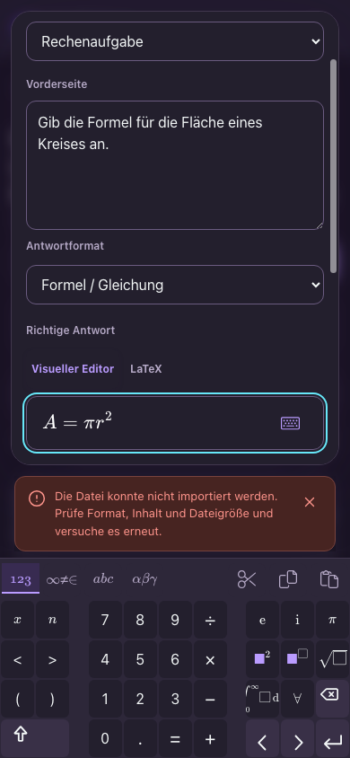

8. Querformat und 400 % Zoom: Formel und Meldungs-Schließen bleiben sichtbar.

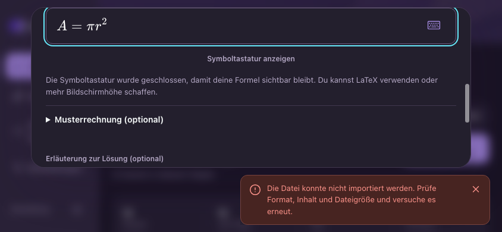

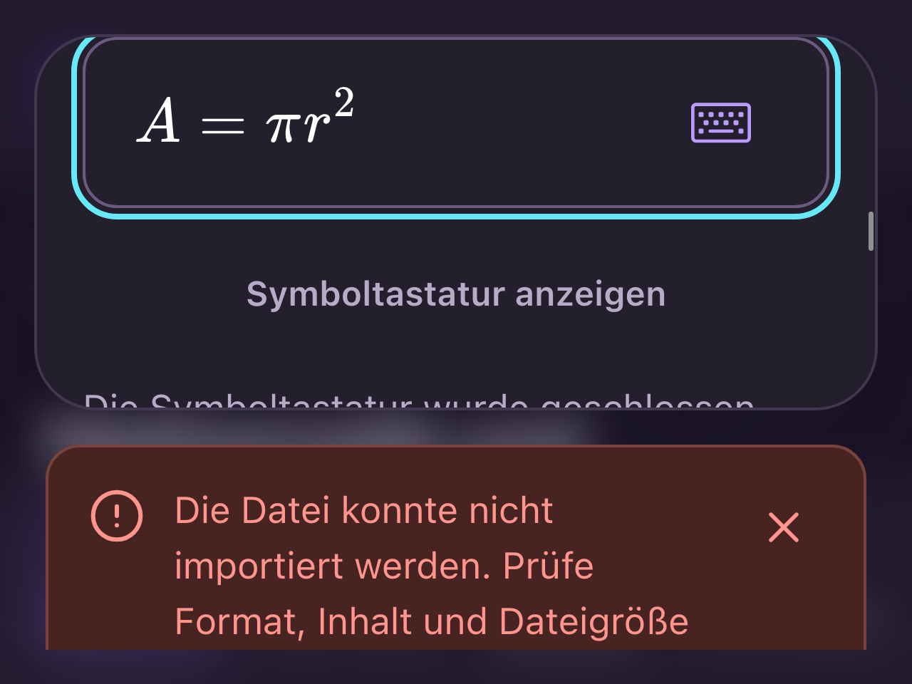

9. Vollständiger Kostenwert auf Tablet-Breite.

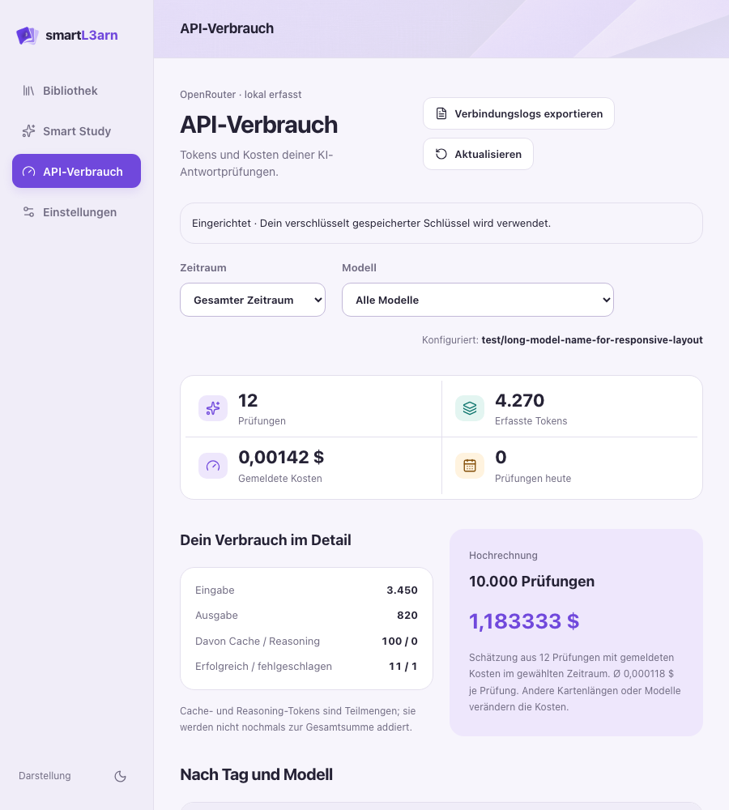

10. Einstellungen und Smart-Study-Konfiguration.

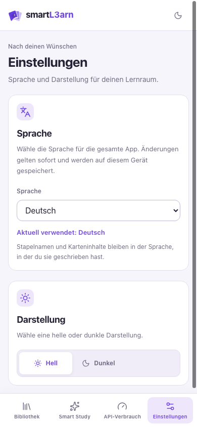

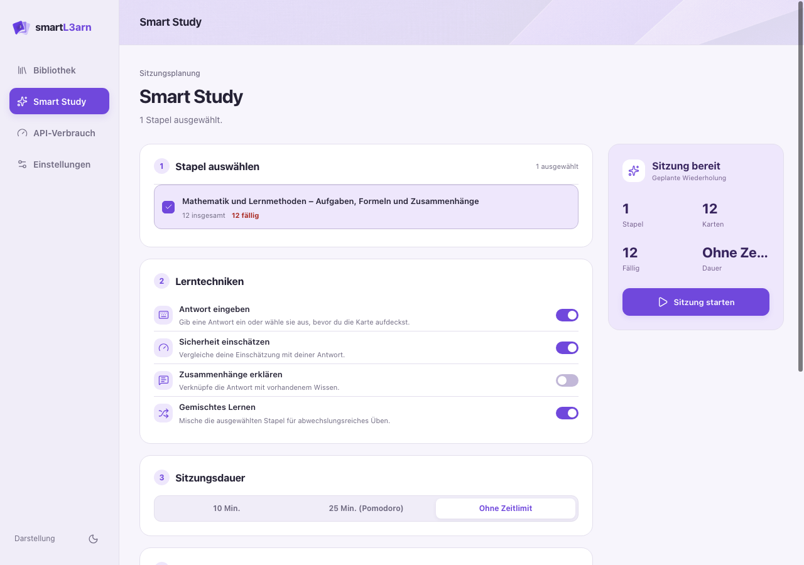

## Prüfung und Grenzen

| Profil | Fenster | Zoom | CSS-Viewport |
| --- | --- | --- | --- |
| Desktop | 1280 × 900 | 100 % | 1280 × 900 |
| Tablet | 900 × 1000 | 100 % | 900 × 1000 |
| Telefon | 390 × 844 | 100 % | 390 × 844 |
| Klein | 320 × 700 | 100 % | 320 × 700 |
| Querformat | 844 × 390 | 100 % | 844 × 390 |
| Zoom 200 | 1280 × 900 | 200 % | 640 × 450 |
| Zoom 400 | 1280 × 960 | 400 % | 320 × 240 |

- `npm run build:web`: Typecheck und Produktionsbuild bestanden.
- `npm test`: 68 Electron- und 207 Vue-/Domain-/Service-Tests bestanden.
- `npm run test:tasks:ui`: zwölf Formate, Desktop/Mobilgröße, echte MathLive-Felder,
  Moduswechsel, lokale Bewertung, simulierte getrennte KI-Prüfung und Standard-Lernen bestanden.
- `npm run test:design`: Layout-/Erreichbarkeitsprüfung auf sieben Größen bestanden.
- `npm run test:smoke`: bestehender App-Smoke-Test bestanden.
- Swift-Prüfskript für `NativeAiJournal`: 29 Prüfungen bestanden.

Die Aufnahmen stammen aus der echten Electron-App mit isoliertem Testprofil,
Beispieldaten und simulierter KI. Es wurden keine echten KI-Anfragen oder
Änderungen an Nutzerdaten vorgenommen. Überdeckte Elemente wurden zusätzlich
durch Scrollen auf Erreichbarkeit geprüft; Hintergrundelemente hinter geöffneten
Menüs und eingeklappte Vorschau-Eingaben zählen nicht als aktive Bedienelemente.

Ein steuerbarer Browser war hier nicht verfügbar. Safari/WebKit, echte iOS- und
Android-Bildschirmtastaturen, Safe-Area-Verhalten auf Geräten, Screenreader und
vollständige Barrierefreiheitskonformität sind damit nicht bestätigt. Im kleinen
Viewport scrollen sowohl längere Dialoge als auch Meldungstexte. Fokus-, Enter-
und Sortierbedienung wurden komponentenweise geprüft; das ersetzt keinen
Screenreader-Test auf einem Gerät.

Alle vollständigen lokalen Aufnahmen liegen unter `design-evidence/design-review/after/`
und `design-evidence/task-types/`. Die ausgewählten Aufnahmen, das Herkunftsmanifest
und [Layoutmessungen](../design-audit/task-types-2026-10-14/metrics.json) bleiben unter
`design-audit/task-types-2026-10-14/` erhalten.
