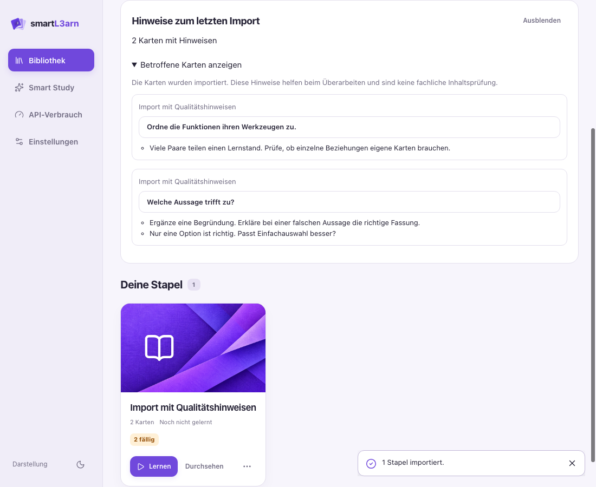
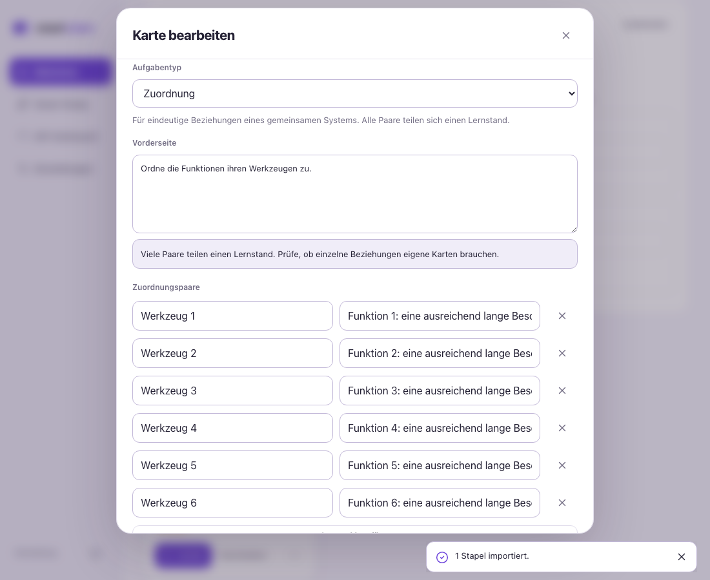
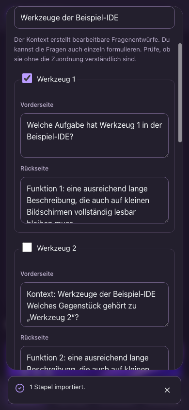
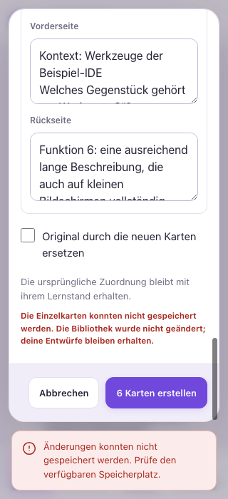
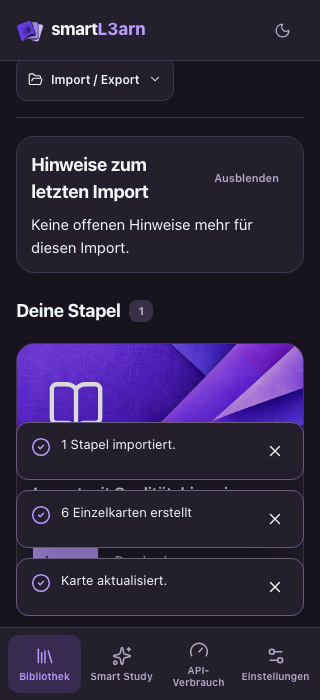
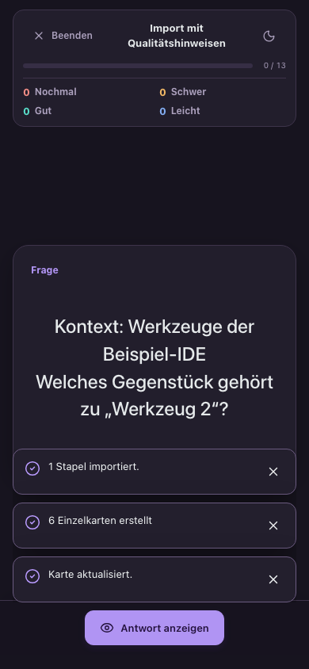

# Umsetzung und Abnahme: Aufgabenqualität

Stand: 13. November 2026. Der [Umsetzungsplan](task-quality-implementation.md)
ist einschließlich Promptvergleich, Editor-/Importhinweisen, Aufteilen und
anschließender Lernrunde umgesetzt.

## Ergebnis für die Nutzung

1. **Erstellen:** Die [Promptvorlage](flashcard-prompt.md) bestimmt zuerst
   eigenständig bewertbare Lernziele, danach Kartengröße und Typ. Die abschließende
   Prüfung entfernt insbesondere Formatdubletten, separate Synonymfragen und
   überflüssige Einzelpositionsfragen zu einer Gesamthierarchie.
2. **Importieren:** Technisch gültige Decks werden gespeichert. Bei Qualitäts-
   hinweisen erscheint eine ausblendbare Übersicht mit direkten Bearbeitungslinks.
   Sie aktualisiert sich nach Änderungen, zeigt höchstens 20 Karten pro Seite und
   erzeugt keine einzelne Meldung pro betroffener Karte. Ungültiges JSON bleibt
   ein technischer Fehler; bei fehlgeschlagenem Speichern entsteht keine falsche
   Erfolgsmeldung oder Übersicht über nicht gespeicherte Karten.
3. **Bearbeiten:** Alle neun Typen haben eine kurze Einsatzhilfe. Dieselben sechs
   lokalen Regeln dienen Editor und Import: große Zuordnungen/Lückentexte/Abläufe,
   fehlende Erklärungen und die beiden auffälligen Mehrfachauswahlfälle. Hinweise
   blockieren keine gültigen Karten. Typwechsel zu Einfachauswahl erhält Optionen
   und richtige ID; die Begründung kann direkt fokussiert werden.
4. **Aufteilen:** Eine gespeicherte Zuordnung kann außerhalb einer Lernsitzung
   über **In Einzelkarten aufteilen** geöffnet werden. Gemeinsamen Kontext
   eingeben oder Fragen einzeln formulieren, Paare auswählen und Entwürfe prüfen.
   Die gemeinsame Originalbegründung bleibt in der Vorschau verfügbar und wird
   nicht ungeprüft in jede neue Antwort kopiert. Das Original bleibt standardmäßig
   erhalten. Ersetzen ist eine eigene ausdrückliche Auswahl.
5. **Lernen:** Jede neue Kurzantwortkarte hat eine neue ID und einen frischen
   Lernstand. Eine Bewertung einer neuen Karte verändert nicht die anderen
   Einzelkarten oder den erhaltenen Original-Lernstand. Alte pausierte Warteschlangen
   mit inzwischen ersetzten Karten werden beim Wiedereinstieg neu aufgebaut.

## Speicherung und Eingaben

Die Aufteilung validiert alle ausgewählten Entwürfe vor dem Speichern. Nach dem
Abschluss vorheriger Speichervorgänge wird ein vollständiger neuer Datenstand
gebildet und einmal gespeichert. Erst bei Erfolg übernimmt die App diesen Stand.
Andere Bibliotheksänderungen und der Start einer Lernsitzung werden währenddessen
verhindert. Bei einem Speicherfehler bleiben Bibliothek, Original-Lernstand und
Entwürfe unverändert; ein erneuter Versuch ist möglich.

Quellkarte und Paar-IDs werden vor dem Übernehmen erneut geprüft. Neue Karten
übernehmen keine Stabilität, Intervalle, Fehlversuche oder sonstige Kartenstatistiken
vom Original. Beim ausdrücklichen Ersetzen werden nur Originalkarte und deren
Kartenstatistiken entfernt, nicht die historische Sitzungsübersicht des Stapels.

Nach Typwechsel und dem Öffnen der Begründung bleibt der Fokus an einem passenden
Feld. Verschwindet ein korrigierter Importeintrag beim Speichern, geht der Fokus
zur Importüberschrift zurück. Die nativen Zuordnungsfelder mit umbrechendem
Anzeigetext bleiben auch in der Dialogvorschau Teil der Tastaturreihenfolge.

## Promptvergleich

Der [dokumentierte Vergleich](prompt-quality/README.md) enthält 54 echte Antworten
von `anthropic/claude-opus-5.5`: 18 mit der vorherigen Vorlage, 18 mit der ersten
Überarbeitung und 18 mit der nachgeschärften Endfassung. Gleiche sechs künstliche
Quelltexte, drei Durchläufe je Fassung, Temperatur 0,2 und maximal 3500 Ausgabetokens.
Die 18 endgültigen Decks enthalten 45 Karten, sind importierbar und wurden gegen
ihre Quelltexte geprüft. Vorlagen, Antworten und Dateiprüfsummen sind versionierbar
unter `docs/prompt-quality/` gespeichert. Es wurden keine persönlichen Decks gesendet.

## Ausgeführte Prüfungen

- `npm run build:web`: Typecheck und Produktionsbuild bestanden. Die bestehende
  Vite-Meldung über große Chunks bleibt bestehen.
- `npm test`: **70 Electron-/Node-Tests und 349 Vue-/Domain-/Service-Tests bestanden**.
  Neue Prüfungen decken Regelgrenzen, gültige Altdecks, gleichzeitige Hinweise,
  Importfehler, Seitenwechsel, stabile Bearbeitungslinks, Fokus, Typwechsel,
  Abbrechen, Änderungen an Entwürfen, Originalerhalt, Ersetzen, neue Lernstände,
  veraltete Quellkarten, vorherige Speichervorgänge und Fehler beim Speichern ab.
- `npm run test:quality:ui`: **36 Aufnahmen**, Breiten 1100, 390 und 320 px, jeweils
  Hell-/Dunkelmodus. Fensterhöhen 900, 844 und 700 px. Tatsächlicher Dateiimport,
  Bearbeitung, Aufteilen, Abbrechen, simulierter Speicherfehler und erneuter Versuch,
  Originalerhalt/Ersetzen, Hinweisbehebung und Rückkehr ins Standardlernen geprüft.
  Kein Seiten-/Dialogüberlauf und keine unerwarteten Rendererfehler festgestellt.
- `npm run test:tasks:ui`: **120 Aufnahmen** für zwölf Antwortformate plus eine
  zusätzliche lange Zuordnung auf Desktop-/Mobilbreite, Editor und beide Lernmodi.
  Keine Rendererfehler oder externen Anfragen in diesem Test.
- Die Prompt-Formatbeispiele und alle 54 gespeicherten Antworten wurden zusätzlich
  mit den vorhandenen Normalisierern verarbeitet. Die aktuelle Promptdatei stimmt
  mit dem eingefrorenen, endgültig geprüften Prompt überein.

Die UI-Tests verwenden isolierte Profile und Beispieldaten. Externe Anfragen sind
dort blockiert; die 54 separat dokumentierten Promptanfragen sind echte Modellaufrufe.
Die absichtlich ausgelösten Speicherfehler erscheinen im Testprotokoll als erwartete
Fehler des simulierten Speichers und wurden mit vollständigem Datenabgleich geprüft.

## Visuelle Belege

Die folgenden Dateien sind unveränderte, visuell geöffnete und geprüfte Aufnahmen.
Lange Dialoge zeigen einen Ausschnitt des scrollbaren Inhalts. Die vollständigen
aktuellen UI-Aufnahmen liegen lokal unter `design-evidence/task-quality/` und
`design-evidence/task-types/`. Die ausgewählten Belege und das Ergebnisprotokoll
bleiben unter `design-audit/task-quality-2026-11-13/` erhalten.

## Grenzen

Die lokalen Regeln erkennen Strukturmerkmale, keine fachliche Wahrheit oder
semantisch unabhängigen Lernziele. Die Promptprüfung bestätigt die untersuchten
künstlichen Quelltexte und das konfigurierte Modell, keine allgemeine Garantie
für beliebige Skripte. Die Endfassung wählte bei Begriffen Freitext; generierte
Lückentext-Synonyme waren deshalb kein eigener Endfassungsfall.

Echte iOS-/Android-Tastaturen, Screenreader und eine neue 400-%-Zoomrunde wurden
nicht geprüft. Bestehende Decks werden nicht automatisch umgeschrieben, neue JSON-Pflichtfelder
oder eigene FSRS-Zustände für Teilantworten wurden nicht eingeführt.
