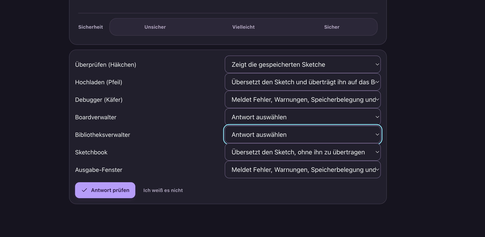
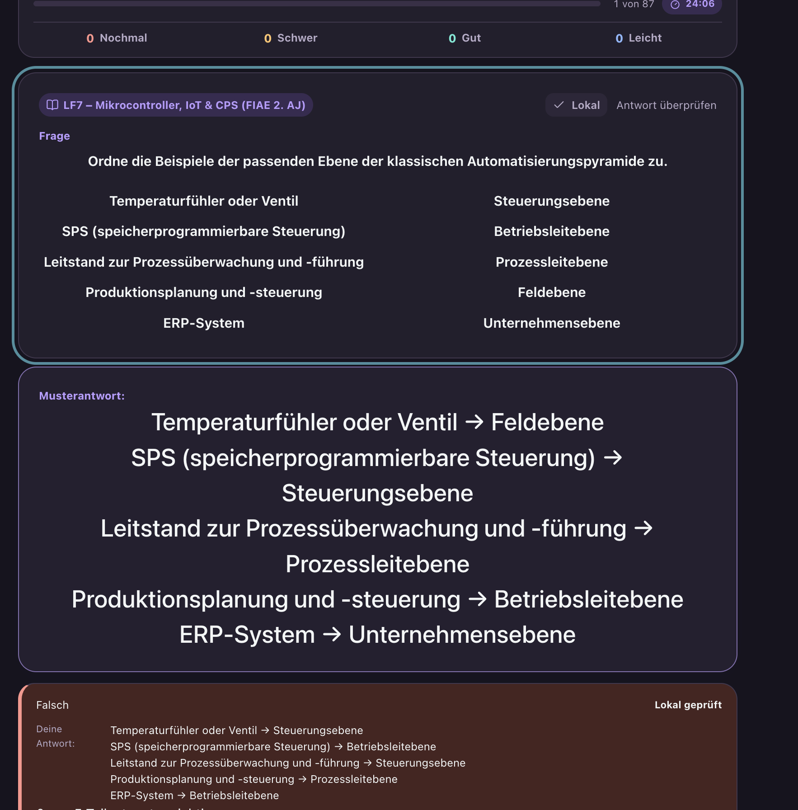
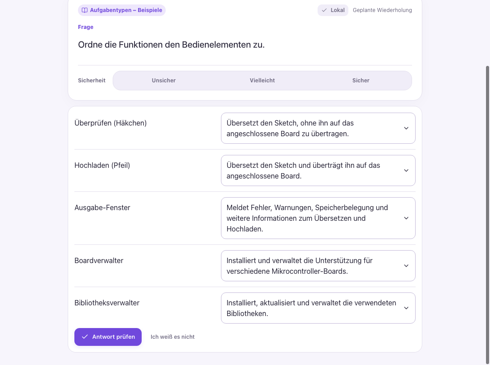
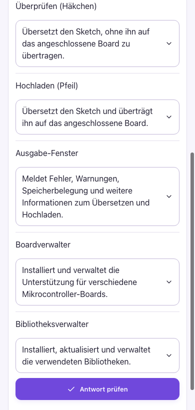
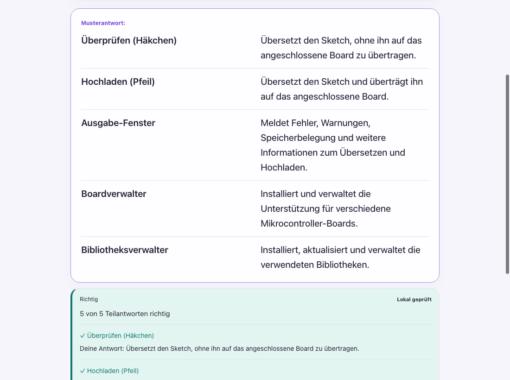
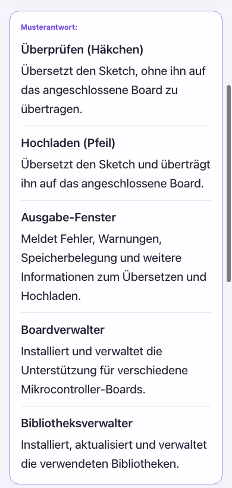
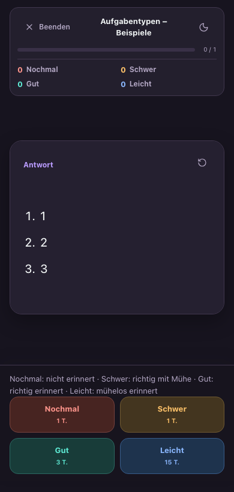

# Spacing und Aufgabentypen – 13. November 2026

Geprüft wurden die beiden vom Nutzer benannten Screens vom 12. November,
18:47 und 18:54, die Aufgabenkomponenten und die Bewertung im aktuellen Code.
Die neuen Aufnahmen stammen aus der echten Electron-App mit isoliertem Profil
und Beispieldaten. Die langen Arduino-Zuordnungen stellen den gemeldeten Fall
nach; sie sind keine Kopie des persönlichen Decks.

## Beobachtung und Korrektur

| Schritt | Befund in den Screens | Änderung und Ergebnis |
| --- | --- | --- |
| 1. Zuordnung beantworten | Die Auswahlfelder berühren sich fast. Ausgewählte lange Antworten werden abgeschnitten. | 12 px Abstand zwischen den Zeilen, zusätzliche Trennlinien, mehr Platz für die Antwortspalte. Die ausgewählte Antwort bricht vollständig um. Auf Mobilbreite steht die Antwort unter dem Begriff. **Gut in den geprüften Größen.** |
| 2. Lösung lesen | Riesige, zentrierte Begriffspaar-Sätze erzwingen Umbrüche und viel Scrollen. Die Frage wiederholt gemischte Antwortoptionen. | Strukturierte Inhalte verwenden linksbündigen Lesetext mit maximal 20 px. Lösungen zeigen semantische Begriffspaare, mobil untereinander; Reihenfolgen erscheinen als nummerierte Liste. Die Rückschau zeigt nur die Frage. **Gut, lange Aufgaben bleiben scrollbar.** |
| 3. Fehler vergleichen | Eigene Zuordnungen stehen als Gesamttext und nochmals in der Teilbewertung. | Der doppelte Gesamttext entfällt bei vorhandener Teilbewertung. Jede Teilantwort bleibt mit ihrem Ergebnis und bei Fehlern mit der erwarteten Antwort sichtbar. **Gut; weniger Wiederholung.** |

Die native Auswahl bleibt für Tastatur, Touch und Hilfstechnologien erhalten;
ein darüber sichtbarer Text stellt den gewählten Wert mit Zeilenumbruch dar.
Die Auswahl hat eine explizite Beschriftung über den jeweiligen Begriff.
Sichtbarer Fokus und deaktivierter Zustand werden an der sichtbaren Fläche
angezeigt. Die Auswahlfläche hat mindestens 44 px Höhe. Screenreader und echte
mobile Auswahlmenüs wurden nicht auf Geräten geprüft.

## Sind alle Aufgabentypen sinnvoll?

**Meine Produktentscheidung: alle neun behalten, ihre Verwendung gezielter machen.
Keine weiteren Typen ergänzen.** Die vier Rechenformate sind sinnvolle Varianten
innerhalb von Rechnen. Kurzantwort und Erklärung sind technisch beide Freitext,
rechtfertigen sich aber durch unterschiedliche Eingabelänge und Lernaufträge.

| Typ | Sinnvoll für | Grenze / redaktionelle Empfehlung |
| --- | --- | --- |
| Kurzantwort | Begriffe, Namen, kurze Fakten, eigenständigen Abruf | Nicht als exakten Wortlauttest für sinngleiche Antworten verwenden. Lokal erfolgt bereits Selbstbewertung. |
| Erklärung | Warum-/Wie-Fragen, Begründungen und Anwendung | Wenige überprüfbare Kernaussagen statt seitenlanger Mustertexte. Freitext benötigt Selbstbewertung oder die optionale KI-Inhaltsprüfung. |
| Rechenaufgabe | Tatsächliche Berechnungen mit Zahl, Bruch, Einheit oder Formel | Rundungstoleranz und erlaubte Einheiten bewusst hinterlegen. Einheitenausdrücke werden nicht beliebig automatisch umgerechnet. Formeln und Rechenwege lokal selbst bewerten. |
| Einfachauswahl | Ähnliche Konzepte voneinander abgrenzen | Plausible falsche Optionen und Erklärung; richtige Antwort nicht durch Länge oder Formulierung verraten. |
| Mehrfachauswahl | Mehrere Merkmale oder Voraussetzungen prüfen | Explizit nach allen zutreffenden Aussagen fragen. Keine Sammlung unabhängiger Themen in einer Karte. |
| Wahr/Falsch | Einen klaren typischen Irrtum prüfen | Für mich der am sparsamsten einzusetzende Typ: zwei Optionen lassen viel Raum für Raten. Falsche Aussage in der Erklärung richtigstellen; für Begründungen eine Erklärungskarte nutzen. |
| Lückentext | Einen gezielten Fachbegriff oder Wert in sinnvollem Kontext abrufen | Keine ganzen Sätze exakt vergleichen. Gültige Synonyme als `alternatives` hinterlegen. Der lokale Vergleich prüft erlaubte Texte, keine freie Semantik. |
| Zuordnung | Eindeutige Beziehungen in einem gemeinsamen Thema, etwa Bedienelement → Funktion | Meist 3–5 knappe Paare als redaktioneller Richtwert, keine technische oder wissenschaftlich feste Obergrenze. Die sieben unabhängigen IDE-Funktionen aus dem Screen würde ich aufteilen. |
| Reihenfolge | Eindeutige zeitliche Abläufe, Größenordnungen oder Hierarchien | Nur verwenden, wenn eine vollständige Reihenfolge fachlich zwingend ist. Der aktuelle Prüfer akzeptiert genau `correctOrder`; gleichwertige Alternativreihenfolgen werden nicht modelliert. |

**Wichtiger als die Typenanzahl ist die Größe einer Karte:** FSRS bewertet und
plant die ganze Karte, nicht einzelne Zuordnungspaare oder Lücken. Sieben
unabhängige Fakten können daher sieben Lernständen entsprechen, erhalten aber
nur einen gemeinsamen. Zusammengehörige Beziehungen lassen sich gut gemeinsam
prüfen; unabhängige Fakten sollten eigene Karten bekommen. Dasselbe gilt für
Mehrfachauswahl und umfangreiche Reihenfolgen.

Diese Empfehlungen sind eine Ableitung für dieses Produkt, keine gemessene
Wirksamkeit der App. Wiederholter Abruf zeigte in der Untersuchung von
[Karpicke und Roediger (2008)](https://pubmed.ncbi.nlm.nih.gov/18276894/)
Vorteile für den späteren Abruf. Auswahlfragen sind deshalb nicht pauschal
ungeeignet: [Butler und Roediger (2008)](https://pubmed.ncbi.nlm.nih.gov/18491500/)
zeigten, dass Feedback bei Multiple-Choice-Tests spätere richtige Antworten
fördern und die Übernahme falscher Ablenker reduzieren kann. Die Empfehlung,
Auswahlaufgaben mit gutem Feedback gezielt einzusetzen, folgt daraus; eine
feste optimale Mischung der neun App-Typen folgt daraus nicht.

Die [Generierungsvorlage](flashcard-prompt.md) enthält jetzt zusätzliche Regeln
für kompakte Zuordnungen, fachlich eindeutige Reihenfolgen und Textlücken mit
gültigen Alternativen. Bestehende Deckinhalte wurden nicht verändert.
Der [Umsetzungsplan](task-quality-implementation.md) konkretisiert jetzt die
Promptregeln und die nächsten App-Schritte für Hinweise und unterstütztes Aufteilen.

## Screenshots

Die Originale liegen unverändert zusammen mit den neuen Aufnahmen unter
`design-audit/task-spacing-2026-11-13/`. Alle unten eingebundenen neuen Bilder
wurden visuell geöffnet und geprüft. Sie zeigen scrollbare Ausschnitte.
Die Originale sind zugeschnitten und haben andere Inhalte/Skalierung;
es handelt sich daher um eine Befundprüfung, keinen pixelgenauen Vergleich.

### Ausgangszustand – Eingabe und Lösung

### Schritt 1 – Vollständige Antworten mit Abstand

### Schritte 2 und 3 – Lesbare Lösung und Teilfeedback

### Weitere Prüfung – Reihenfolge im Standardmodus

## Verifikation und Grenzen

- Produktionsbuild einschließlich Typecheck erfolgreich.
- `npm test`: 70 Electron-/Node-Tests und 319 Vue-/Domain-/Service-Tests.
- `npm run test:tasks:ui`: 120 Aufnahmen, zwölf Antwortformate plus eine zusätzliche
  lange Zuordnung auf 1100 und 390 px Fensterbreite; Eingabe, Prüfung, Editor und
  Standardmodus. Kein festgestellter Seiten-/Dialogüberlauf, keine Rendererfehler
  und keine externen Netzwerkanfragen. Die Mindestabstände, vollständigen
  ausgewählten Antworttexte, Lösungspaare und begrenzte Lösungsschrift werden
  zusätzlich im UI-Test geprüft.
- Neue Komponententests sichern Begriffspaare, Erklärungen und die konfigurierte
  Lösungsreihenfolge. Die bestehende Zuordnungsprüfung kontrolliert jetzt auch
  sichtbare Werte und Beschriftungen.
- Weitere aktuelle Aufnahmen: `design-evidence/task-types/` (lokal, nicht versioniert).
- Kein Zugriff auf persönliche Lerndaten, keine echten KI-Anfragen. Kein Test
  auf echten iOS-/Android-Geräten, mit Screenreader oder einer neuen 400-%-Zoomrunde.
  Die Prüfung bestätigt keine vollständige Barrierefreiheit oder Lernwirksamkeit.
